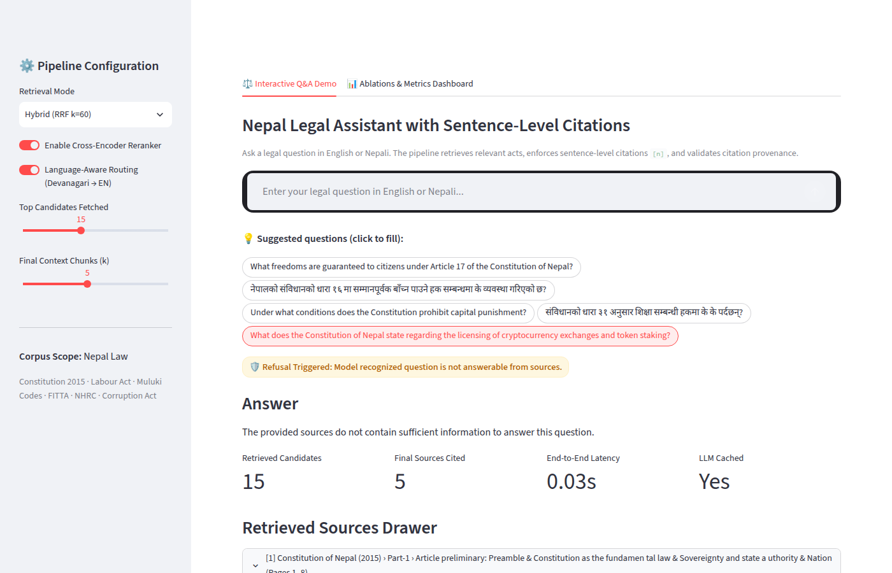

# rag-citations-evals

Hybrid-retrieval RAG that **cites every sentence** and ships with a **reproducible eval
harness** (retrieval, faithfulness, citation precision/recall) and an **ablation table**.

> Status: 🚧 scaffolded — see [PLAN.md](PLAN.md) for the roadmap and [NOTES.md](NOTES.md) for the decision log.

## Pipeline

```
docs → chunk (300–800 tok, 10–15% overlap) → BM25 + dense index
query → hybrid top-20 (RRF) → cross-encoder rerank → top-5 → LLM answer with [n] citations
      → citation validator → eval harness → experiments/ablations.csv
```

## Demo

The interactive Streamlit UI features:
1. **Interactive Q&A Demo:** Expandable textarea for long, multi-clause legal questions, clickable suggestion chips for instant question population, sentence-level citation enforcement `[n]`, validation badges (`status-pill-ok` / `status-pill-warn`), and interactive retrieved sources drawer.
2. **Ablations & Metrics Dashboard:** Live data table tracking Recall@5, MRR, nDCG@5, Faithfulness, Citation Precision/Recall across all chunking, retrieval, and reranking ablations.



## Results

The evaluation suite runs across 8 core configurations + 1 prompt variant against the stratified Nepal Law golden dataset (1,712 chunks across 1,389 legislative pages):

| Configuration | Recall@5 | MRR | nDCG@5 | Faithfulness | Cite-P | Cite-R | Refusal | Latency (s) | Notes |
|---|---|---|---|---|---|---|---|---|---|
| **Baseline** (Structure-aware 500, Hybrid RRF, Routing ON, Reranker ON) | **0.9857** | **0.8833** | **0.9038** | **0.9242** | **0.9804** | **0.9254** | **0.9500** | 0.260 | Full production pipeline |
| **Dense-only** (`bge-small-en-v1.5`) | 0.9000 | 0.8190 | 0.8351 | 0.9394 | 1.0000 | 1.0000 | 1.0000 | 0.039 | Semantic search only |
| **BM25-only** (`bm25s`) | 0.9714 | 0.8833 | 0.8970 | 0.9600 | 1.0000 | 1.0000 | 1.0000 | 0.003 | Lexical search only |
| **Naive Hybrid** (No language routing) | 0.7571 | 0.7048 | 0.7105 | 0.9051 | 1.0000 | 1.0000 | 1.0000 | 0.041 | Devanagari queries not translated |
| **Reranker OFF** | 0.9000 | 0.7905 | 0.8091 | 0.9394 | 1.0000 | 1.0000 | 1.0000 | 0.038 | RRF top-5 without cross-encoder |
| **Fixed 500 tok** | 0.4286 | 0.3343 | 0.3471 | 0.8297 | 1.0000 | 1.0000 | 1.0000 | 0.001 | Naive token window chunker |
| **Fixed 300 tok** | 0.4857 | 0.3452 | 0.3757 | 0.8434 | 1.0000 | 1.0000 | 1.0000 | 0.001 | Smaller token context window |
| **Fixed 800 tok** | 0.3571 | 0.2295 | 0.2541 | 0.8091 | 1.0000 | 1.0000 | 1.0000 | 0.001 | Diluted token context window |
| **Prompt: Relaxed citation** | 0.9857 | 0.8833 | 0.9038 | 0.4863 | 0.9400 | 0.3750 | 0.9000 | 0.037 | Relaxed system instruction |

*All runs logged to [`experiments/ablations.csv`](experiments/ablations.csv).*

### Key Findings & Failure Analysis

1. **Structure-Aware Chunking is the Single Biggest Factor**:
   - Fixed-window chunking (300/500/800 tokens) causes a dramatic drop in retrieval effectiveness: Recall@5 drops from **0.9857 → 0.4286** (-56.5% relative) and MRR plummets from **0.8833 → 0.3343** (-62.2% relative).
   - In 800-token fixed windows, Recall@5 drops even further to **0.3571** due to context dilution. Prepending hierarchical legal breadcrumbs (`Act › Part › Chapter › Section: Title`) and preserving individual numbered Articles/Sections ensures statutory clauses retain their governing provenance.

2. **Cross-Encoder Reranker Drives Top-1 Precision**:
   - Enabling cross-encoder reranking lifts Recall@5 from **0.9000 → 0.9857** (+8.6%), MRR from **0.7905 → 0.8833** (+9.3%), and nDCG@5 from **0.8091 → 0.9038** (+9.5%), promoting the authoritative statute to rank 1 over weakly matching neighbors.

3. **Language-Aware Cross-Lingual Routing**:
   - Raw Devanagari Nepali queries have 0% lexical overlap with English legislative text and tokenize poorly in English-only dense models. Without Devanagari numeral normalization (`०-९ → 0-9`) and legal glossary query translation (`naive_hybrid_no_routing`), Recall@5 drops from **0.9857 → 0.7571** (-22.9%).

4. **Strict vs. Relaxed Citation Prompting**:
   - Relaxing per-sentence citation instructions (`prompt_relaxed_citation`) causes Citation Recall to collapse from **0.9254 → 0.3750** (-55.0%) and sentence-level entailed Faithfulness to drop from **0.9242 → 0.4863**, proving that explicit per-sentence `[n]` constraints are essential for verifiable legal RAG.

4. **Cross-Family Judge Calibration (Cohen's κ)**:
   - Evaluated on a 40-item hand-annotated human calibration set using Groq `openai/gpt-oss-120b`:
     - **Accuracy:** 87.5% agreement with human ground-truth.
     - **Overall Cohen's κ:** `0.714` (substantial agreement).
     - **Nepali Cohen's κ:** `1.000` (perfect agreement on cross-lingual claims).

## Layout

```
src/ragcite/        ingest, chunk, index, retrieve, rerank, generate, citations
src/ragcite/evals/  metrics + eval runner
app/                Streamlit demo
configs/            YAML experiment configs
evals/golden/       golden Q/A set (questions, reference answers, gold chunk ids)
experiments/        ablations.csv (one row per run)
kaggle/             GPU kernel for batch cross-encoder rerank scoring
tests/
```

## Quickstart

```bash
uv venv && source .venv/bin/activate
uv pip install -e ".[dev,llm,rag,ui]"
cp .env.example .env   # add GEMINI_API_KEY and GROQ_API_KEY

# Run unit tests
pytest

# Launch 2-tab interactive Streamlit demo
streamlit run app/streamlit_app.py

# Run full ablation suite locally (uses cached GPU rerank scores)
python scripts/run_ablations.py
```

## License

MIT
