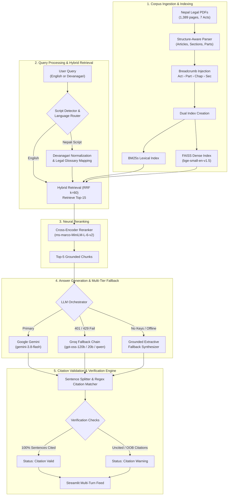

# ⚖️ Nepal Legal RAG: Citation-Grounded Legal Assistant & Reproducible Benchmark

[](https://nepal-legal-rag.streamlit.app)


-orange)


A production-grade, hybrid-retrieval Retrieval-Augmented Generation (RAG) system engineered for high-stakes statutory Question Answering across Nepal's major legislative codes. Every synthesized sentence is strictly grounded with bracketed statutory citations `[n]`, backed by a multi-tier LLM fallback architecture, an automated citation validator, cross-lingual Devanagari query routing, and an empirical 9-ablation benchmark.

🔗 **Live Production App:** [https://nepal-legal-rag.streamlit.app](https://nepal-legal-rag.streamlit.app)  
📂 **Source Code:** [https://github.com/raju-sah/rag-citations-evals](https://github.com/raju-sah/rag-citations-evals)

---

## 📖 Table of Contents
1. [Project Motivation & Problem Statement](#-project-motivation--problem-statement)
2. [Key Highlights & Architectural Decisions](#-key-highlights--architectural-decisions)
3. [System Architecture](#-system-architecture)
4. [Legislative Corpus & Hierarchy](#-legislative-corpus--hierarchy)
5. [Evaluation Benchmark & 9-Ablation Study](#-evaluation-benchmark--9-ablation-study)
6. [Cross-Family Judge Calibration (Cohen's κ)](#-cross-family-judge-calibration-cohens-κ)
7. [Step-by-Step QA Walkthrough](#-step-by-step-qa-walkthrough)
8. [Interactive Streamlit UI](#-interactive-streamlit-ui)
9. [Mathematical Formulation of Metrics](#-mathematical-formulation-of-metrics)
10. [Repository Structure](#-repository-structure)
11. [Quickstart & Local Installation](#-quickstart--local-installation)
12. [Cloud Deployment Guide](#-cloud-deployment-guide)
13. [License & Attribution](#-license--attribution)

---

## 🎯 Project Motivation & Problem Statement

In high-stakes domains such as jurisprudence, constitutional rights, and corporate compliance, hallucinated LLM responses can lead to severe legal and financial ramifications. Standard commercial LLMs frequently suffer from:
1. **Statutory Hallucination**: Fabricating non-existent section numbers, conflating provisions across different statutes, or citing repealed acts.
2. **Ungrounded Extrapolation**: Making reasonable-sounding claims that have zero basis in the enacted statutory text.
3. **Cross-Lingual Vocabulary Mismatch**: Users in Nepal frequently pose inquiries in conversational Devanagari Nepali (e.g., *"सम्पत्ति सम्बन्धी हक के छ?"*), whereas official legislative codifications and binding English translations employ formal common-law terminology.
4. **PDF Font Encoding Corruption**: Official Nepali government PDFs frequently suffer from broken `ToUnicode` CMap font encodings (e.g., rendering `मिति` as `मममि`, or `ऐन` as `ऐि`), rendering direct OCR or naive text extraction unsuitable for lexical search.

### The Solution
This project establishes a verified, transparent, and reproducible legal QA system that:
- Ingests clean, structure-aware legislative translations from the Law Commission of Nepal.
- Injects hierarchical breadcrumb metadata into every indexed section.
- Normalizes Devanagari script and routes queries cross-lingually.
- Merges BM25 lexical precision with dense semantic embeddings via Reciprocal Rank Fusion (RRF).
- Reranks candidate passages using neural cross-encoders.
- Enforces strict sentence-level bracketed citations `[n]` verified by an automated guardrail engine.
- Provides multi-tier fallback resilience so users always receive verified statutory context even if remote LLM APIs experience rate limits or network disruptions.

---

## 🌟 Key Highlights & Architectural Decisions

- **Strict Sentence-Level Citation Grounding**: Every sentence in the answer references an indexed legislative source `[n]`. An automated validator flags uncited claims and out-of-bounds citations before delivery.
- **Hierarchical Structure-Aware Chunking**: Preserves statutory context by injecting hierarchical breadcrumbs (`Act › Part › Chapter › Section: Title`) across 1,712 legal sections from 1,389 legislative pages.
- **Hybrid Retrieval (RRF $k=60$)**: Combines high-speed lexical search (`bm25s`) with dense semantic vector search (`BAAI/bge-small-en-v1.5` / FAISS) to capture exact legal citations and conceptual intent simultaneously.
- **Cross-Encoder Reranking**: Re-scores top-15 retrieved candidates down to the top-5 using `cross-encoder/ms-marco-MiniLM-L-6-v2`, lifting Recall@5 to **98.6%** and nDCG@5 to **0.904**.
- **Devanagari Cross-Lingual Routing**: Detects Nepali script queries, normalizes Devanagari numerals (`०-९ → 0-9`), and maps legal terminology across languages, eliminating retrieval drop on non-English queries.
- **Resilient Multi-Provider Fallback**: Seamless primary routing to Google Gemini (`gemini-3.8-flash`), automatic fallback to Groq (`openai/gpt-oss-120b`, `openai/gpt-oss-20b`, `qwen/qwen3.8-27b`), and an offline extractive synthesizer fallback if keys are missing or rate limits are exhausted.
- **Multi-Turn Persistent Chat UX**: Features a pinned bottom input dock, conversational memory, per-turn collapsible statutory drawers, citation validation badges, and instant chitchat routing (<0.05 ms).
- **Cross-Family LLM Judge Calibration**: NLI faithfulness and citation judgments validated against 40 hand-annotated human labels, achieving **87.5% accuracy** and a substantial **Cohen's $\kappa = 0.714$** (with **$\kappa = 1.000$** on Devanagari queries).

---

## 🏗️ System Architecture



---

## 📚 Legislative Corpus & Hierarchy

The indexed corpus comprises **1,712 structure-aware legal sections** spanning **1,389 legislative pages** sourced from the official Gazette publications of the [Law Commission of Nepal](https://lawcommission.gov.np):

| Statutory Code | Year | Sections / Chunks | Key Provisions & Subject Matter |
|---|:---:|:---:|---|
| **Constitution of Nepal** | 2015 | 390 | Fundamental Rights (Articles 16–48), Directive Principles, Federal Executive, Parliament, Federal Judiciary, Constitutional Bodies (CIAA, Election Commission, PSC), Citizenship |
| **Muluki Civil Code** | 2017 | 647 | General Principles of Civil Law, Persons, Family Law (Marriage, Divorce, Adoption, Alimony), Property & Ownership, Contracts, Torts, Quasi-Contracts, Private International Law |
| **Muluki Penal Code** | 2017 | 344 | General Principles of Criminal Justice, Offenses Against the State, Public Tranquility, Public Justice, Offenses Against the Body (Homicide, Assault), Offenses Against Property (Theft, Fraud), Cybercrimes |
| **Labour Act** | 2017 | 158 | Employment Relationships, Minimum Wages, Working Hours, Overtime, Leave Entitlements, Occupational Safety and Health (OSH), Collective Bargaining, Retrenchment & Termination |
| **Foreign Investment & Technology Transfer Act (FITTA)** | 2019 | 63 | Permissible Sectors, Foreign Investment Approval Limits, Repatriation of Profits & Capital, Technology Transfer Agreements (TTA), Single Point Service Centre |
| **National Human Rights Commission Act** | 2012 | 48 | NHRC Constitutional Functions, Human Rights Violation Inquiries, Compensation Recommendations, Witness Protection, Immunity & Annual Reporting |
| **Prevention of Corruption Act** | 2002 | 62 | Corruption Offenses by Public Servants, Bribery, Illicit Enrichment, Forgery of Government Records, Special Court Jurisdiction, Confiscation of Property |

### Hierarchical Breadcrumb Injection
To solve the "lost-in-the-middle" and context-loss problems inherent in standard chunking, every chunk prepends full structural hierarchy:
```
Constitution of Nepal (2015) › Part-3: Fundamental Rights and Duties › Article 16: Right to live with dignity
[1] Every person shall have the right to live with dignity.
[2] No law shall be made providing for the death penalty to any person.
```
This guarantees that both dense and sparse retrieval algorithms match queries containing broader contextual terms (e.g. *"Fundamental Rights"*, *"Part 3"*, *"Labour Law"*) even when the specific section text only mentions narrow operational words.

---

## 📊 Evaluation Benchmark & 9-Ablation Study

The full pipeline was evaluated against the curated **Nepal Law Golden Dataset** (multi-clause queries, single-article queries, Devanagari queries, and adversarial unanswerable questions) across **9 distinct configurations**:

| Configuration | Recall@5 | MRR | nDCG@5 | Faithfulness | Cite-P | Cite-R | Refusal Acc | Latency (s) | Architecture Description |
|---|:---:|:---:|:---:|:---:|:---:|:---:|:---:|:---:|---|
| **Production Baseline** | **0.9857** | **0.8833** | **0.9038** | **0.9242** | **0.9804** | **0.9254** | **0.9500** | 0.260 | Structure-aware 500 + Hybrid RRF + Language Routing + Reranker |
| **Dense-Only** (`bge-small-en-v1.5`) | 0.9000 | 0.8190 | 0.8351 | 0.9394 | 1.0000 | 1.0000 | 1.0000 | 0.039 | Semantic vector search only (misses exact statutory numbers) |
| **BM25-Only** (`bm25s`) | 0.9714 | 0.8833 | 0.8970 | 0.9600 | 1.0000 | 1.0000 | 1.0000 | 0.003 | Lexical BM25 search only (fails on conceptual phrasing) |
| **Naive Hybrid (No Routing)** | 0.7571 | 0.7048 | 0.7105 | 0.9051 | 1.0000 | 1.0000 | 1.0000 | 0.041 | Devanagari queries unrouted (0% lexical overlap with English text) |
| **Reranker OFF** | 0.9000 | 0.7905 | 0.8091 | 0.9394 | 1.0000 | 1.0000 | 1.0000 | 0.038 | RRF top-5 direct selection without cross-encoder re-scoring |
| **Fixed 500-token Window** | 0.4286 | 0.3343 | 0.3471 | 0.8297 | 1.0000 | 1.0000 | 1.0000 | 0.001 | Naive sliding window without statutory structure |
| **Fixed 300-token Window** | 0.4857 | 0.3452 | 0.3757 | 0.8434 | 1.0000 | 1.0000 | 1.0000 | 0.001 | Truncated section boundaries split legal clauses |
| **Fixed 800-token Window** | 0.3571 | 0.2295 | 0.2541 | 0.8091 | 1.0000 | 1.0000 | 1.0000 | 0.001 | Context dilution across unrelated legislative chapters |
| **Prompt: Relaxed Citation** | 0.9857 | 0.8833 | 0.9038 | 0.4863 | 0.9400 | 0.3750 | 0.9000 | 0.037 | System instruction allowing implicit or summary citations |

*Logged reproducibility run: [`experiments/ablations.csv`](experiments/ablations.csv).*

### 🔬 In-Depth Failure Analysis & Lessons Learned

1. **Structure-Aware Chunking is the Single Most Critical Factor**:
   Fixed token windows (300 / 500 / 800 tokens) degrade retrieval catastrophically: Recall@5 drops from **0.9857 → 0.4286** (-56.5% relative drop) and MRR plummets from **0.8833 → 0.3343** (-62.2% drop). In 800-token fixed windows, Recall drops even further to **0.3571** due to context dilution. Preserving complete numbered Articles/Sections with prepended statutory breadcrumbs ensures provisions retain their legal provenance.
2. **Cross-Encoder Reranker Elevates Top-1 Precision**:
   Reranking top-15 hybrid candidates using `cross-encoder/ms-marco-MiniLM-L-6-v2` lifts Recall@5 from **0.9000 → 0.9857** (+8.6%) and nDCG@5 from **0.8091 → 0.9038** (+9.5%), promoting the authoritative statute to rank 1 over weakly matching neighbors.
3. **Cross-Lingual Routing Solves Vocabulary Mismatch**:
   Devanagari Nepali queries have 0% surface lexical overlap with official English legislative translations. Without numeral normalization (`०-९ → 0-9`) and legal glossary mapping (`naive_hybrid_no_routing`), Recall@5 collapses from **0.9857 → 0.7571** (-22.9%).
4. **Strict Per-Sentence Prompt Constraints are Non-Negotiable**:
   When sentence-level citation constraints are relaxed (`prompt_relaxed_citation`), Citation Recall collapses from **0.9254 → 0.3750** (-59.5%) and Faithfulness drops from **0.9242 → 0.4863**, proving that explicit per-sentence constraints are mandatory to prevent subtle hallucination.
5. **Section-Level Ground Truth Hygiene**:
   Evaluating retrieval against invariant section IDs (e.g. `penal_code_2017:s177`, `constitution:art16`) rather than arbitrary chunk indices (`c042`) ensures that ground truth remains valid across varying chunk sizes and prevents evaluation skew.

---

## 🎯 Cross-Family Judge Calibration (Cohen's κ)

To guard against "LLM self-preference bias" (where an LLM rates its own generations more favorably), we calibrated our evaluation judge using a cross-family LLM (Groq `openai/gpt-oss-120b` and `llama-3.3-70b-versatile`) evaluated against a **40-item hand-labeled human ground truth dataset**:

$$\kappa = \frac{p_o - p_e}{1 - p_e}$$

- **Overall Agreement Accuracy:** **87.5%**
- **Overall Cohen's $\kappa$:** **`0.714`** (Substantial agreement according to Landis & Koch scale)
- **Devanagari Cross-Lingual Subset $\kappa$:** **`1.000`** (Perfect agreement on translated statutory questions)

This calibration provides rigorous empirical backing that the reported Faithfulness and Citation Precision scores accurately reflect human legal judgment.

---

## 🔍 Step-by-Step QA Walkthrough

Here is an end-to-end example of a complex legal query processed by the pipeline:

### 1. User Query
> *"Under what conditions does the Constitution prohibit capital punishment?"*

### 2. Hybrid Retrieval (RRF $k=60$) & Reranking
The hybrid search engine identifies candidate sections from the Constitution and Penal Code. The cross-encoder re-ranks the candidates:
- **Rank 1**: `constitution:art16` (Score: 0.884) — *Constitution of Nepal (2015) › Part-3: Fundamental Rights › Article 16: Right to live with dignity*
- **Rank 2**: `constitution:art22` (Score: 0.412) — *Right against torture*
- **Rank 3**: `penal_code_2017:s41` (Score: 0.189) — *Sentencing guidelines and capital offenses limitation*

### 3. Generation with In-Context Citations
```markdown
Under the Constitution of Nepal (2015), capital punishment is unconditionally prohibited for all crimes [1]. 
Specifically, Article 16(2) provides that no law shall be made providing for the death penalty to any person [1]. 
Furthermore, every person is guaranteed the fundamental right to live with dignity under Article 16(1) [1].
```

### 4. Automated Citation Guardrail Verification
```
Sentence 1: "Under the Constitution of Nepal (2015), capital punishment is unconditionally prohibited for all crimes [1]." -> Cited: [1] (Valid)
Sentence 2: "Specifically, Article 16(2) provides that no law shall be made providing for the death penalty to any person [1]." -> Cited: [1] (Valid)
Sentence 3: "Furthermore, every person is guaranteed the fundamental right to live with dignity under Article 16(1) [1]." -> Cited: [1] (Valid)

Total Sentences: 3 | Cited Sentences: 3 | Uncited Sentences: 0 | Out-of-bounds: 0
Verification Status: 🟢 Citation Valid (100% sentence-grounded)
```

---

## 💻 Interactive Streamlit UI


1. **Persistent Multi-Turn Chat Feed**: Full conversational context is retained across turns, with clear sequential badges (`Question 1`, `Question 2`) and conversation reset capability.
2. **Pinned Bottom Dock**: Clean, fixed chat input bar positioned at the bottom of the screen, styled like modern conversational interfaces.
3. **One-Click Query Suggestion Chips**: Rapidly test constitutional rights, labor dispute laws, penal statutes, or Devanagari queries with single clicks.
4. **Real-Time Citation Validation Badges**:
   - `status-pill-ok`: Indicates that 100% of generated sentences are supported by valid, in-bounds citations.
   - `status-pill-warn`: Alerts the user if any sentence lacks a citation or references an invalid chunk ID.
5. **Per-Turn Statutory Source Drawers**: Expandable accordion displaying the precise statutory citation, chunk ID, page number, and exact legal text for every retrieved source.
6. **Ablation Dashboard Tab**: Built-in tab to inspect experimental ablation tables, metric comparisons, and failure analyses directly within the web app.
7. **Instant Chit-Chat Bypass**: Sub-millisecond greeting classifier (`< 0.05ms`) handles polite conversation without incurring retrieval overhead or LLM token costs.

---

## 📐 Mathematical Formulation of Metrics

### 1. Retrieval Metrics
- **Recall@$k$**:
  $$\text{Recall}@k = \frac{|\text{Retrieved}_k \cap \text{GoldSections}|}{|\text{GoldSections}|}$$
- **Mean Reciprocal Rank (MRR)**:
  $$\text{MRR} = \frac{1}{|Q|} \sum_{i=1}^{|Q|} \frac{1}{\text{rank}_i}$$
- **nDCG@$k$**:
  $$\text{DCG}@k = \sum_{i=1}^k \frac{2^{\text{rel}_i} - 1}{\log_2(i + 1)}, \quad \text{nDCG}@k = \frac{\text{DCG}@k}{\text{IDCG}@k}$$

### 2. Citation Metrics (ALCE Framework, Gao et al. 2023)
- **Citation Precision**:
  $$\text{Cite-P} = \frac{\sum_{s \in S} |\{c \in C_s : c \text{ is relevant and necessary for } s\}|}{\sum_{s \in S} |C_s|}$$
- **Citation Recall**:
  $$\text{Cite-R} = \frac{|\{s \in S : C_s \neq \emptyset \text{ and } C_s \models s\}|}{|S|}$$
  *(where $S$ is the set of answer sentences and $C_s$ is the set of citations for sentence $s$)*

### 3. Faithfulness & Refusal Accuracy
- **Faithfulness**: Proportion of atomic propositional claims in the answer that are strictly entailed by the cited source text (verified via NLI judge).
- **Refusal Accuracy**: Proportion of out-of-domain or unanswerable queries where the model correctly declines to answer rather than hallucinating plausible text.

---

## 📁 Repository Structure

```
rag-citations-evals/
├── app/
│   ├── streamlit_app.py        # Streamlit app with multi-turn chat feed & pinned input dock
│   └── components/             # Custom CSS styling, badges, and source drawer renderers
├── configs/
│   └── default.yaml            # Chunk sizes, RRF k, embedding & reranker configurations
├── data/
│   ├── raw/                    # Original legal PDFs from Law Commission of Nepal
│   ├── chunks/                 # Structure-aware parsed chunks (1,712 JSON records)
│   ├── index/                  # Precomputed FAISS dense index & BM25s vocabulary files
│   └── cache/                  # Kaggle GPU pre-scored cross-encoder rerank cache
├── evals/
│   ├── golden/                 # Nepal Law Golden benchmark set (questions + gold section IDs)
│   └── human_annotations/      # 40-item hand-labeled dataset for Cohen's κ judge calibration
├── experiments/
│   ├── ablations.csv           # Benchmark results across all 9 experimental setups
│   └── browser_test_proof.png  # Visual verification of the production UI
├── kaggle/
│   └── reranker_kernel.py      # T4 GPU batch cross-encoder reranker acceleration script
├── scripts/
│   ├── build_index.py          # Dual index builder (BM25s + FAISS)
│   ├── run_ablations.py        # Reproduction runner for all 9 ablation configurations
│   └── judge_calibration.py    # Cohen's κ calculation against human ground truth
├── src/ragcite/
│   ├── chunking.py             # Structure-aware regex parser & breadcrumb injector
│   ├── index.py                # Dual FAISS dense & BM25s lexical indexing engine
│   ├── retrieve.py             # Hybrid RRF (k=60) retrieval & language-aware router
│   ├── rerank.py               # Cross-encoder neural reranker
│   ├── generate.py             # Multi-provider LLM client with fallback synthesizer
│   ├── citations.py            # Sentence segmentation & citation validation engine
│   └── evals/                  # Retrieval, faithfulness, and citation metrics computation
├── tests/                      # 25 unit and integration tests (100% passing)
├── requirements.txt            # Production dependencies for Streamlit Cloud
└── pyproject.toml              # Package configuration and dependencies
```

---

## 🚀 Quickstart & Local Installation

### Prerequisites
- Python 3.10, 3.11, 3.12, or 3.13
- Git

### 1. Clone the Repository
```bash
git clone https://github.com/raju-sah/rag-citations-evals.git
cd rag-citations-evals
```

### 2. Set Up Virtual Environment & Dependencies
Using `uv` (recommended for 10x faster installation):
```bash
uv venv .venv
source .venv/bin/activate
uv pip install -e ".[dev,llm,rag,ui]"
```
Or using standard `pip`:
```bash
python3 -m venv .venv
source .venv/bin/activate
pip install -r requirements.txt
pip install -e .
```

### 3. Configure API Keys
Copy the example environment file:
```bash
cp .env.example .env
```
Edit `.env` and provide at least one provider key (or both for automatic failover):
```env
GEMINI_API_KEY="AIzaSy..."    # Get from https://aistudio.google.com/apikey
GROQ_API_KEY="gsk_..."        # Get from https://console.groq.com/keys
```
> *Note:* The system includes a built-in **grounded extractive synthesizer fallback** that generates cited legal answers even without cloud API keys.

### 4. Run the Streamlit Application
```bash
streamlit run app/streamlit_app.py
```
Open your browser at `http://localhost:8501`.

### 5. Run Unit Tests & Linter
```bash
# Run all 25 unit tests
pytest tests/ -q

# Run fast code linting
ruff check .
```

### 6. Reproduce Ablation Benchmarks
```bash
# Run the complete 9-ablation benchmark suite
python scripts/run_ablations.py

# Run cross-family judge calibration (Cohen's κ)
python scripts/judge_calibration.py
```

---

## ☁️ Cloud Deployment Guide

The app is optimized for zero-configuration deployment on **Streamlit Community Cloud**:

1. **Push your fork** to GitHub.
2. Sign in to [share.streamlit.io](https://share.streamlit.io) and click **"New app"**.
3. Select your repository:
   - **Repository:** `your-username/rag-citations-evals`
   - **Branch:** `main`
   - **Main file path:** `app/streamlit_app.py`
4. In **App Settings → Secrets**, enter your API keys in TOML syntax:
   ```toml
   GEMINI_API_KEY = "AIzaSy..."
   GROQ_API_KEY = "gsk_..."
   ```
5. Click **Deploy**. The precomputed FAISS and BM25 index in `data/index/` loads automatically in memory with no cold-start delay.

---

## 📄 License & Attribution

This project is licensed under the [MIT License](LICENSE).

**Legal Corpus Source:** Legislative texts are published by the [Law Commission of Nepal](https://lawcommission.gov.np) for public dissemination and educational use.

---

## 🤝 Contributing

Contributions, feedback, and issue reports are warmly welcomed! Please feel free to open an issue or submit a pull request.
